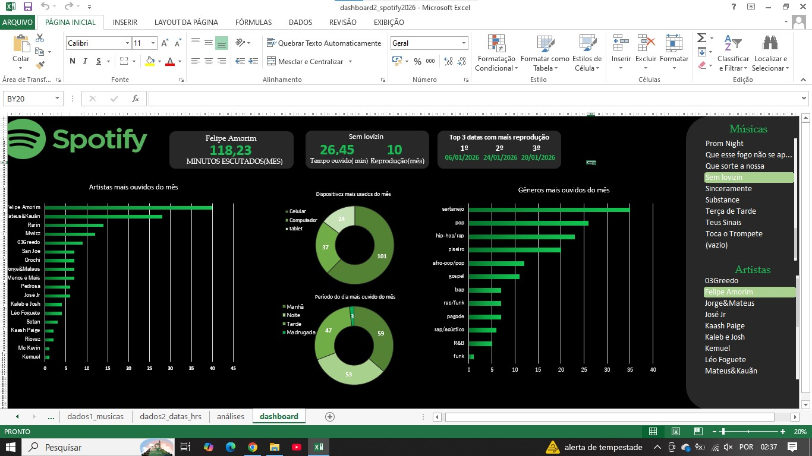

# dashboard-spotify-excel
Dashboard de análise musical mensal desenvolvido no Excel

##Sobre o projeto

Dashboard desenvolvido no Excel para analisar meus hábitos de escuta musical durante um mês

##Análises relizadas

-Artistas mais ouvidos

-Gêneros musicas mais reproduzidos

-Reproduções por período de dia

-Dias com maior quantidade de reproduções

-Quantidade de reproduções e tempo ouvido por música

-Dispositivos mais utilizados

##Ferramentas ultilizadas

-Microsoft Excel

-Tabelas dinâmicas

-Gráficos e cartões indicaadores

##Visualização do dashboard

